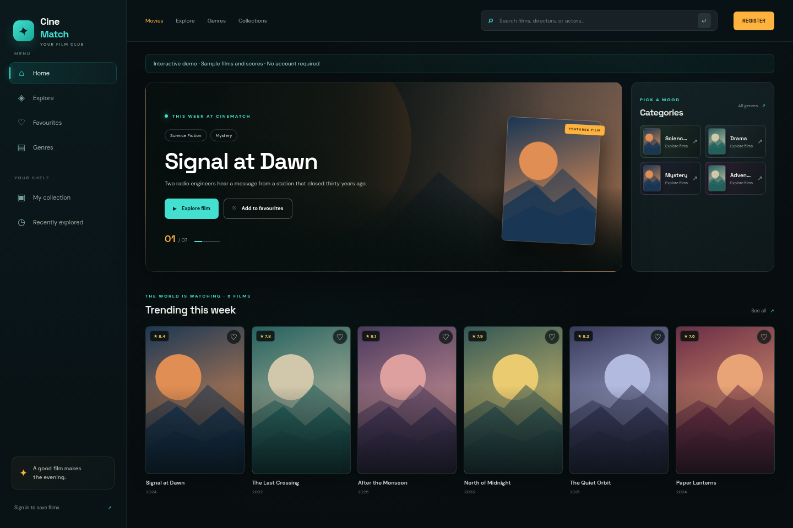
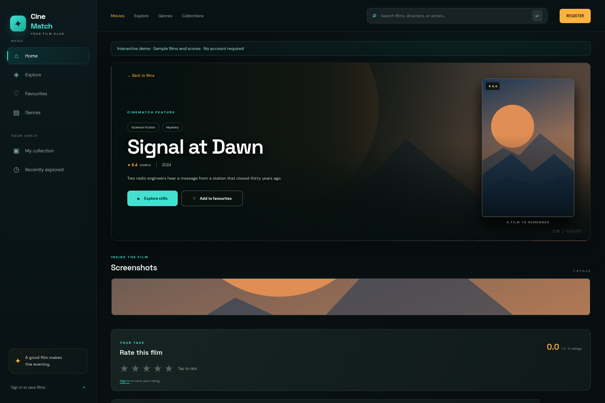

# CineMatch AI  🎬

**Discover movies. Explore recommendations. Find your next favourite film.**

CineMatch AI  is a movie discovery and recommendation platform built with React, Spring Boot, PostgreSQL, and The Movie Database (TMDB) API. The project combines a modern web interface with a Java REST API to help users search for movies and explore related recommendations.

The project is being developed to incorporate more personalized, AI-powered movie recommendations.

## Live demo and screenshots

[Open the interactive CineMatch demo](https://raw.githack.com/YASH101105/CineMatch-AI/gh-pages/index.html)

Try searching for **Paper Lanterns**, browsing **Genres**, or opening **Signal at Dawn** to see related films. This preview runs the project’s React interface with six fictional films, original sample artwork, and example scores. The full application uses Spring Boot, PostgreSQL, and TMDB for live movie data and account features.

| Discovery | Film details |
| --- | --- |
|  |  |

GitHub Actions captures these screens in Chrome from the same build it publishes. To run the preview locally, use `npm ci` and `npm run dev -- --mode demo` in `frontend/`.

## ✨ Features

- **Movie Search:** Search for movies by title using TMDB.
- **Movie Details:** Retrieve movie information from the backend API.
- **Movie Recommendations:** Fetch recommendations for a selected movie.
- **Trending Movies:** Support for retrieving trending movie data.
- **Genre Discovery:** Explore movies using genre-based discovery endpoints.
- **REST API Backend:** Java Spring Boot services for handling movie-data requests.
- **Database Integration:** PostgreSQL configuration for application data.
- **Modern Frontend:** React and Vite for a responsive web experience.

> **Development status:** Movie search and the TMDB recommendation endpoint have been tested successfully. Frontend integration, additional personalization, and AI-based recommendation features are ongoing development work.

## 🛠️ Tech Stack

| Layer | Technologies |
|---|---|
| Frontend | React, JavaScript, CSS |
| Frontend tooling | Vite, Node.js, npm |
| Backend | Java, Spring Boot |
| API | REST, TMDB API |
| Database | PostgreSQL |
| Backend build tool | Maven |
| Version control | Git and GitHub |

## 🏗️ Project Structure

```text
CineMatch-AI/
├── backend/       # Spring Boot application and REST APIs
├── frontend/      # React + Vite application
├── docs/          # Project documentation
├── .github/       # GitHub configuration
├── .gitignore
└── README.md
```

## 🚀 Getting Started

### Prerequisites

Install the following tools before running the project:

- Java JDK compatible with the project's Maven configuration
- Maven
- Node.js and npm
- PostgreSQL
- A TMDB account and API Read Access Token

### 1. Clone the repository

```bash
git clone https://github.com/YASH101105/CineMatch-AI.git
cd CineMatch-AI
```

### 2. Configure PostgreSQL

Create a PostgreSQL database named `cinematch_ai` and configure a database user with the required permissions.

The backend uses these environment variables:

- `CINEMATCH_DB_USERNAME`
- `CINEMATCH_DB_PASSWORD`
- `TMDB_BEARER_TOKEN`

Make sure the database connection settings in the backend match your local PostgreSQL configuration.

### 3. Start the backend

Open a terminal in the project directory and run:

```zsh
cd backend

export CINEMATCH_DB_USERNAME=cinematch_app

read -s "CINEMATCH_DB_PASSWORD?Enter your PostgreSQL password: "
export CINEMATCH_DB_PASSWORD
echo

read -s "TMDB_BEARER_TOKEN?Enter your TMDB Read Access Token: "
export TMDB_BEARER_TOKEN
echo

mvn spring-boot:run
```

Keep this terminal open while using the application. The backend runs on port `8080` with the current local configuration.

### 4. Start the frontend

Open a **second terminal** and run:

```bash
cd frontend
npm install
npm run dev
```

Open the local URL displayed by Vite, typically:

```text
http://localhost:5173
```

The current Vite configuration proxies `/api` requests to the backend at `http://localhost:8080`.

### 5. Build the frontend

To verify that the frontend can be built for production:

```bash
cd frontend
npm run build
```

The generated production files are placed in the `dist` directory.

## 🔌 Backend API Endpoints

The current backend includes these TMDB-related endpoints:

| Method | Endpoint | Purpose |
|---|---|---|
| GET | `/api/health` | Check backend health |
| GET | `/api/tmdb/search?query=Interstellar` | Search movies |
| GET | `/api/tmdb/movie/{id}` | Retrieve movie details |
| GET | `/api/tmdb/movie/{id}/recommendations` | Retrieve movie recommendations |
| GET | `/api/tmdb/movie/{id}/images` | Retrieve movie images |
| GET | `/api/tmdb/genres` | Retrieve available genres |
| GET | `/api/tmdb/discover?genreId={id}` | Discover movies by genre |
| GET | `/api/tmdb/trending` | Retrieve trending movies |

These endpoints return data from the backend, with TMDB supplying the movie information.

## 🔐 Security

- Never commit TMDB access tokens, database passwords, or other credentials.
- Store secrets in environment variables or an untracked local environment file.
- Keep `.env`, build output, dependency folders, and IDE-specific files out of version control.
- If a credential is accidentally published, revoke or rotate it immediately.

## Contributing

Contributions are welcome! Read the [contribution guide](CONTRIBUTING.md), [code of conduct](CODE_OF_CONDUCT.md), [security policy](SECURITY.md), and [six-month roadmap](ROADMAP.md).

See [open issues](https://github.com/YASH101105/CineMatch-AI/issues) for tasks. The project is in early development; feedback and reproducible bug reports are especially useful.

## License

Project code is available under the [MIT License](LICENSE). Third-party dependencies, TMDB metadata and imagery remain subject to their respective terms.

## 👨‍💻 Author

**Yash Rastogi**

- GitHub: [@YASH101105](https://github.com/YASH101105)

## 📄 Disclaimer

CineMatch AI is an independent learning and development project. Movie metadata is provided through TMDB, subject to its applicable terms and attribution requirements.
